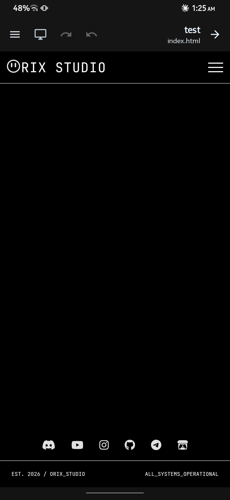
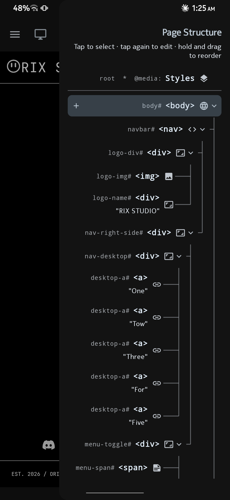

# Better HTML

Build HTML, CSS and JavaScript websites visually, right on your Android phone. No code editor, no typing CSS: every element, property and state is set through visual controls, and the app writes real, clean files you can use anywhere.

[](https://github.com/OrixStudio/Better-HTML/releases/latest)


## Download

Get the APK from the [Releases](https://github.com/OrixStudio/Better-HTML/releases) page. Each release has its own notes describing what changed.

## Screenshots

<p align="center">
  
  &nbsp;&nbsp;
  
</p>

To install, open the APK on your phone and allow installs from your browser or file manager when Android asks.

**Requirements:** Android 7.0 (API 24) or newer.

## What you can do

- **Build the page as a tree.** Add, nest, fold and drag elements around. The tree opens from the right edge by swiping.
- **Style with classes, like a real site.** The first class on an element is its main class and the target of its CSS. Elements that share a class share its style.
- **Edit 160+ CSS properties visually.** Colors, spacing, borders, typography, backgrounds, layout, positioning and effects, with dedicated editors for transforms, filters, shadows, transitions, animations, grids and more. Every property has an `!important` toggle.
- **Style states.** Hover, focus, active, `nth-child` and other pseudo-classes and pseudo-elements, plus toggled classes such as `.open`.
- **Make it responsive.** Screen rules for width, height, orientation and color scheme, each holding only the properties that change.
- **Reuse values across the project.** Define colors, sizes, fonts, shadows, gradients and transitions once; they are written as `:root` variables on every page.
- **Preview as you build.** Live preview with a phone and desktop toggle.
- **Control the page head.** Title, charset, viewport and meta tags, plus per-page CSS library links that are checked before they are accepted.
- **Manage images** through the system photo picker, with no storage permission needed.
- **Export** the whole project as a ZIP.

## What it produces

Everything the app writes is plain files on the device, updated with every change:

```
projects/{slug}/
├── project.json
├── pages/{name}.json
├── {name}.html
├── css/
├── js/
└── img/
```

## Status

Better HTML is in alpha. Things move fast and some rough edges remain. If you find a bug or something that feels wrong, please open an [issue](https://github.com/OrixStudio/Better-HTML/issues) and say which version you are on.

## License

Copyright (c) Orix Studio. All rights reserved.

Better HTML is proprietary, closed-source software. This repository hosts releases and documentation only. No permission is granted to copy, modify, redistribute or sell the app or any part of it without prior written permission from the author.
